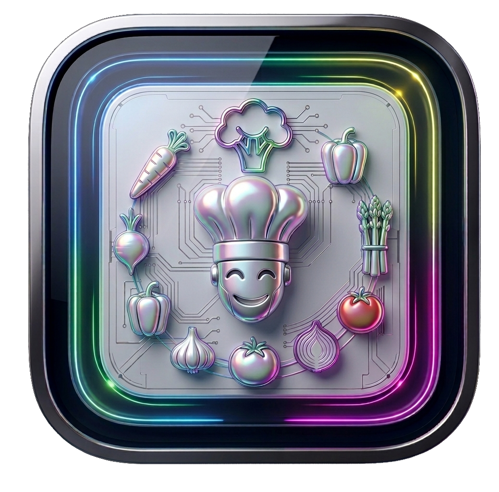
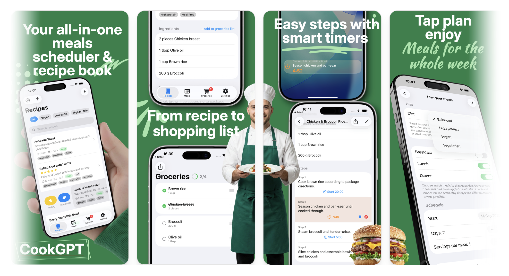

<h3>CookGPT</h3>

<strong>CookGPT - Gourmet Plan & Taste</strong> is a native <strong>SwiftUI</strong> iOS app for recipes, meal planning, and grocery lists — with step timers on the Lock Screen and Dynamic Island.

  

<picture>
  <source media="(prefers-color-scheme: dark)" srcset="../.github/screenshot_dark.png"/>
  <source media="(prefers-color-scheme: light)" srcset="../.github/screenshot.png"/>
  
</picture> 

### Features

| | |
|---|---|
| **Recipe library** | Browse, favorite, filter by category, scale servings, share, and add custom recipes |
| **Meal planner** | Schedule lunch and dinner by day, week, or month — or auto-plan a full week |
| **Shopping lists** | Generate grocery lists from scheduled meals or selected recipes |
| **Cooking timers** | Per-step timers with Live Activities on Lock Screen and Dynamic Island |
| **Diet-aware planning** | Plan meals for balanced, vegetarian, vegan, or high-protein diets |

  <a href="https://cook-gpt.pages.dev"><strong>Website</strong></a>
  &nbsp;·&nbsp;
  <a href="https://github.com/cook-gpt"><strong>GitHub</strong></a>
  &nbsp;·&nbsp;
  <a href="https://github.com/cook-gpt/.github"><strong>Organization</strong></a>

---

### Public repositories

| Repository | Summary |
|------------|---------|
| [**.github**](https://github.com/cook-gpt/.github) | Organization profile, governance, and automation (this page) |

Application source is maintained in a **private** repository and is not linked here.

> This page is rendered from **`profile/README.md`** in the [`.github`](https://github.com/cook-gpt/.github) repository — the public face of [github.com/cook-gpt](https://github.com/cook-gpt).

---

Maintained by <a href="https://github.com/charlite">@charlite</a>

